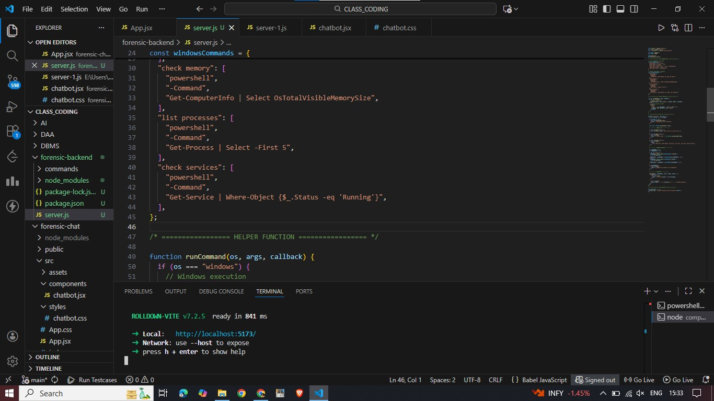
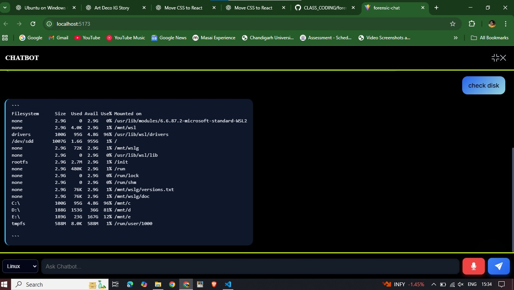
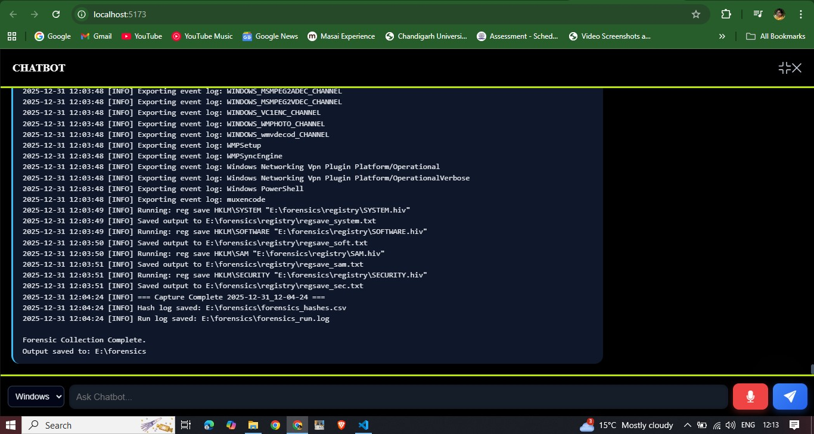

# DevSecOps Security Automation Chatbot

An OS-aware chatbot that triggers forensic data collection on **Windows (PowerShell)** and **Linux (via WSL)** from a single chat interface. The React frontend sends a request to a Node.js/Express backend, which runs only **pre-approved (allow-listed) scripts** and rejects everything else.

Built for DevSecOps and incident-response scenarios where an analyst wants one controlled entry point for evidence capture instead of running scripts by hand on each machine.

## Screenshots

| | | |
|---|---|---|
|  |  |  |

## Features

- **OS-aware chat UI:** pick Windows or Linux and the backend runs the matching capture script.
- **Allow-listed execution:** the backend keeps a fixed map of permitted commands; any other message returns "Command not allowed or not recognized."
- **Windows collection (PowerShell):** gathers running processes, logged-in users, network state (connections, ARP cache, routing table, DNS cache), Windows event logs (`.evtx`) and registry hives, with optional memory acquisition and packet tracing.
- **Evidence integrity:** every collected file is hashed (SHA-256) into a CSV manifest, and each run writes a log.
- **Linux collection (WSL):** triggers a Bash capture script inside WSL without blocking the UI.
- **Voice-command input** in the chat interface.

## Architecture

```
React (Vite)  ──POST /api/chat──▶  Express (Node.js)  ──▶  allow-list lookup
  chat UI + OS selector              localhost:5000              │
                                                                 ├─ windows ▶ powershell.exe -File scripts/capture.ps1
                                                                 └─ linux   ▶ wsl.exe bash scripts/capture.sh
```

| Part | Folder | Stack |
|---|---|---|
| Frontend | `forensic-chat/` | React 19, Vite |
| Backend | `forensic-backend/` | Node.js, Express 5, CORS |
| Capture scripts | `scripts/` | PowerShell, Bash |

### API

`POST /api/chat`

```json
{ "message": "run forensic capture", "os": "windows" }
```

| Message (case-insensitive) | `os` | Action |
|---|---|---|
| `run forensic capture` | `windows` | Runs the PowerShell capture script |
| `run linux forensic capture` | `linux` | Starts the Bash capture script in WSL |
| `hello`, `time`, `help` | any | Small talk / usage help |
| anything else | any | Rejected: "Command not allowed or not recognized." |

## Security design

- **Allow-list, not free-form execution.** User text is only matched against fixed keys in `windowsCommands` and `linuxCommands` in `forensic-backend/server.js`. User input is never inserted into a shell command, so there is no command injection through the chat box.
- **Fixed script paths.** The commands that run are constants in the server, not values supplied by the client.
- **Hash manifest.** SHA-256 hashes of collected artifacts let you verify they weren't altered after collection.

## Prerequisites

- Node.js 18+ and npm
- Windows 10/11 with PowerShell
- WSL with a Linux distro installed (for the Linux capture)
- An **elevated (administrator)** terminal for the backend, since the script reads event logs and registry hives
- Optional: `winpmem` or `DumpIt` on your `PATH` for memory capture

## Setup

```bash
# 1. Clone
git clone https://github.com/AyushRao-13/DevSecOps-Security-Automation-Chatbot.git
cd DevSecOps-Security-Automation-Chatbot

# 2. Backend
cd forensic-backend
npm install
node server.js          # http://localhost:5000

# 3. Frontend (new terminal)
cd forensic-chat
npm install
npm run dev             # http://localhost:5173
```

### Configure script paths

The capture scripts live in `scripts/`. Open `forensic-backend/server.js` and point the two entries at your copies:

```js
const windowsCommands = {
  "run forensic capture": "<full path to>\\scripts\\capture.ps1",
};

const linuxCommands = {
  "run linux forensic capture": {
    type: "script",
    command: "<WSL path to>/scripts/capture.sh",
  },
};
```

Also update the WSL path inside `runCommand()` in the same file. The Windows script's output folder is set at the top of `scripts/capture.ps1`.

## Usage

1. Open the frontend, choose **Windows** or **Linux**.
2. Type `help` to see the available commands, or type `run forensic capture`.
3. When the script finishes, the chat shows its result and the collected files appear in the output folder together with the log and hash manifest.

## Known limitations

This is a learning/prototype project meant for **local use on a machine you own or are authorised to investigate**.

- No authentication on the API, and CORS is open to any origin, so don't expose the backend to a network.
- The PowerShell script runs with `-ExecutionPolicy Bypass` and requires administrator rights.
- One capture command per OS; the allow-list is intentionally small.
- Script paths are set in `server.js` rather than environment variables.
- Collected data (registry hives, event logs, memory dumps) is sensitive. Store it securely and never commit it to Git.

## Roadmap

- Move script paths and the port into environment variables
- Add authentication and restrict CORS to the frontend origin
- Add more allow-listed read-only commands (for example disk usage, open ports, scheduled tasks)
- Return a downloadable report from the UI

## Tech stack

React, Vite, Node.js, Express, PowerShell, Bash, WSL, Windows, Linux

## Author

Ayush Yadav · [GitHub](https://github.com/AyushRao-13)

